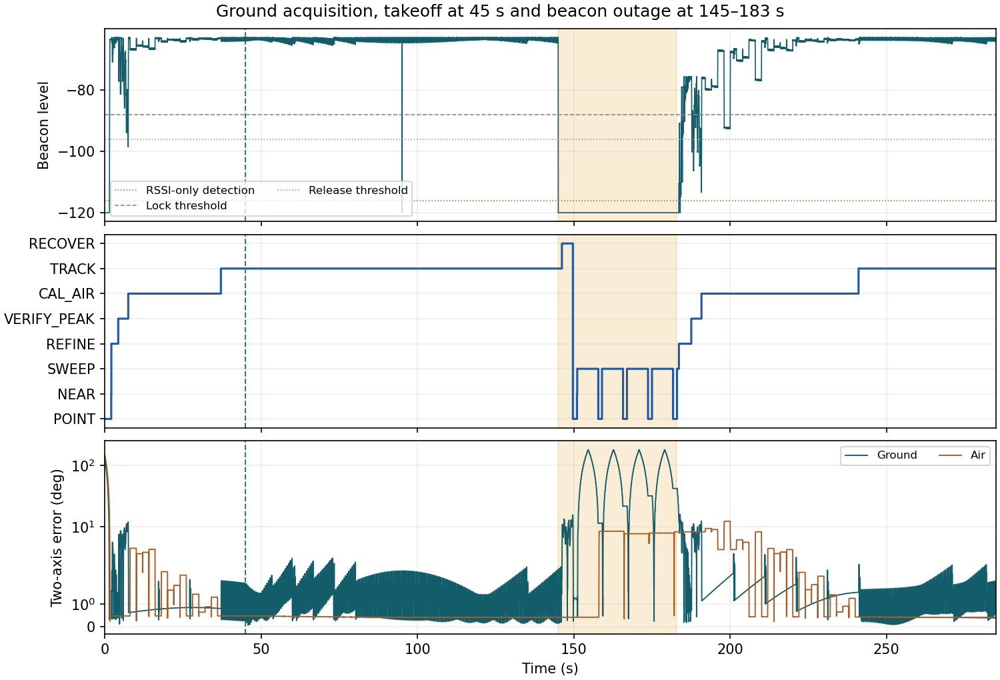

# 机载与车载通信天线跟踪

地面就绪 → 按位置与航向互指 → 收到信标即十字寻峰、宽网格复核、机端校正、回峰确认锁定；互指后未检出才扫全周。捕获后机端继续运动补偿，车端双轴仅靠信标纠偏。地面、起飞、飞行、降落共用一套状态机。

[双端动作、参数与跳转](docs/双端对准与跟踪.md) · [状态机图](docs/两端对准状态机.svg) · [离线交互手册](docs/tracking-guide/dist/index.html)

## STM32 接入

* 机端编译 `common/link.c` 与 `airborne/airborne.c`，车端编译 `common/link.c` 与 `vehicle/vehicle.c`，使用 C99 和数学库。两端每 10 ms 运行一次控制任务。建议使用指定成员初始化外设输入结构。
* 机端在控制任务内持有零初始化的 `AirHistory`；调用 `airborne_track_step(&history, now, &air, &reply)` 才会自动从定位历史补偿运动。无历史的 `airborne_point_step` 保留给静态几何对照。位置报文只有经纬高、测量时刻和有效位，速度由机内推算。只有航向时，俯仰和横滚置零，角速率有效位置 false。
* 车端启动时初始化一次 `Vehicle`；每拍调用 `vehicle_step(&scanner, now, &ground)`。首次粗方位采用 `rough_heading_deg, heading_ms, heading_valid`；无可用航向时从当前编码器角附近开始。两端都填本机编码器、状态和测量时刻。使能由设备工作状态决定，请勿用离地高度或飞控解锁标志触发 `vehicle_init`。
* 方位是各端自身云台的单圈绝对角 [0°,360°)，跨零取最短角差。两端编码器反馈和目标俯仰角均为 0°～90°。0° 时天线面竖直、波束水平；机端读数向下增加，90° 时正对下方；车端读数向上增加，90° 时正对上方。标准安装的 `el_zero_deg` 为 0、`reverse_el` 为 false。机端的姿态变换在输出前完成，LoRa 的 `el_trim` 仍是在地理仰角上叠加的有符号修正。越过机械行程的目标限幅，越界的编码器反馈进入 WAIT_DATA。
* 安装标定时，将基座朝前且波束水平时的编码器读数写入 `GimbalFrame`，按实际编码器方向设置反向位。`Command.valid=false` 时忽略占位角。
* 经纬度用 WGS‑84 十进制度，两端高度需统一基准。GGA 度分字段用 `gga_degrees(raw, hemisphere, &deg)` 转换，例如 3430.000,N 为 34.5°。现有车载工程的一条解析路径直接除以 100，接入时应核对数据来源。GGA 海拔加上带符号的大地水准面分离值后为椭球高。
* 每秒一轮 LoRa 双向通信。车发本机位置、状态和 `Vehicle.request`，机发本机位置、状态和 `AirReply`。按字段编解码；用会话号、传输序号和时间戳拒绝重复/乱序帧。定位的时间戳是测量时刻折算到本地单调时钟，协调帧使用本地接收时刻。应用层原子传递完整输入快照。硬件适配层实现实际收发和伺服驱动。

接收机若提供信标存在位，在 `VehicleInput` 逐帧设置 `has_beacon_flag=true`、`beacon_present` 和有效 RSSI。仅有强度时按实测噪底设置 `detect_level`。`acquire_level` 只作峰值质量门限及跟踪阶段复校判据。`near_step_deg` 是 5×5 峰值复核网格的间距。

## 调参

```c
Vehicle scanner;
VehicleConfig cfg = vehicle_defaults;
cfg.near_step_deg = 4;
cfg.sweep_step_deg = 10;
cfg.detect_level = -116;   /* RSSI-only detection fallback */
cfg.acquire_level = -88;   /* final lock qualification */
cfg.release_level = -96;
cfg.refine_start_deg = 4;
cfg.refine_min_deg = 1;
cfg.refine_factor = 0.5;
cfg.refine_max_rounds = 12;
vehicle_init(&scanner);
bool applied = vehicle_configure(&scanner, &cfg);
```

配置仅在启动或整组参数确有变化时应用。有效配置从 NEAR 重新开始；起飞时沿用原来的配置、中心和阶段。每个参数的用途见详细手册。

## 鼠标交互仿真

在项目根目录启动桌面窗口：

```powershell
python sim/interactive.py
```

需要带 Tkinter 的 Python 3.8+ 和本机 GCC 或 Clang。首次运行会自动编译两端 C 控制器，之后复用缓存。若编译器不在 PATH，可将环境变量 `CC` 指向编译器可执行文件。改动控制器源码或头文件后，下次打开会重新编译。

* 在俯视图拖橙色无人机或绿色车辆改变经纬度，拖圆形航向柄或从设备上按右键拖动改变航向。滚轮向上以鼠标位置为中心放大，向下缩小，点「适配视野」可重新看到两端。侧视图上下拖动设备圆点改变高度，可模拟起飞。拖动不会重置控制器。
* 左栏分别显示两端经纬高、平台航向、云台实测方位与俯仰。编辑字段后按回车或点对应设备的「应用」。手工修改云台实测角可模拟外力扰动，下一控制拍起伺服会从这个角度继续追随目标。下方的目标角是控制器输出，两组角均以各自云台零点为基准。
* 左栏顶部是当前阶段、两端输出状态、信标强度和最近一次跳转原因。下方记录按仿真时间列出历次跳转。可暂停、加速到 64 倍或勾选「遮挡信标」观察重捕。要看完整重新对准，可保持遮挡至 NEAR 或 SWEEP，再取消遮挡。
* 右下方状态图可切换控制阶段、机端输出、车端输出。深绿为所选对象的当前状态，浅绿为最近经过的状态，箭头标出最近一次跳转。下方按发生顺序记录最近八个状态，能看到复校、重捕等回程。机端执行指向时可同时看到控制阶段在推进。
* 两端方位和俯仰默认各限速 5°/s，方位跨零走短弧。「伺服速度配置」可分别设置四根轴的速度上限，应用后从下一控制拍生效，0 表示该轴停转。信标和编码器每 10 ms 更新，本地定位每 100 ms 更新，两端每秒交换一次 LoRa 快照。播放倍率只改变仿真时间的推进速度。
* 信标由双方实际波束指向及斜距共同计算。示例天线的半功率半角为 6°，19° 处有 −19 dB 的旁瓣。同轴相距 500 m 时强度约为 −62，接收机从 −116 起报告检出。交互场景默认两端水平、定位无偏差、车端粗航向偏差 +3°。方向图和链路预算均为演示假设，可在 `sim/antenna_model.py` 中替换为实测曲线。
* 「重置」恢复初始位置、航向和云台角，清空两端控制历史、遮挡及计时记录。保留当前伺服限速、播放倍率和暂停状态，便于在同样配置下重复试验。
* 「重锁记录」按仿真时间逐次保存失锁时刻、重新锁定时刻和间隔，包含失锁后持续遮挡和云台转动的时间。首次捕获单独显示。计时在重新进入 TRACK、双端主瓣与信号质量通过复核时结束。默认 `air_recheck_ms=0`，稳定跟踪时持续运动补偿和小十字跟踪。显式设置正值才启用周期复校。
* 交互模型启用 `fast_acquire`。车端五点十字确认中心达到已标定的锁定门限、邻点无明显改善后，首次捕获直接进行机端双轴探测。机端强峰稳定即回峰采满 5 帧确认。弱峰仍可进入完整精扫和 25 点宽网格复核。失锁后先检查 3×3 局部网格，整轮最优点仍比锁定门限低超过 8 dB 时，回到最新几何方向。几何重对准过程中检出信标时继续对准，避免折返旧峰。
* 俯视图把两副天线半功率圆锥画到当前斜距，并投影到水平面。左栏的三维离轴角包含俯仰误差。当前模型在车端偏离约 19° 时仍可能检出旁瓣。状态图中的 TRACK 表示控制器正在跟踪采样；左栏同时显示此刻是否真正处于双端主瓣且满足保持条件。
* 交互仿真每轮 LoRa 更新时依据两站距离估算同轴强度 P（近距离上限 −40），锁定线为 max(−112, P−2)，保持线为 max(−115, P−3)。控制器依靠接收信号判别，三维真值供显示与仿真验证。已锁定后，连续 250 ms 的新鲜弱帧会触发局部重捕。优先复测旧峰或邻近候选点，经小十字寻峰及双端回峰复测才能重新锁定。弱候选继续完整搜索。两项可选策略由 `VehicleConfig.fast_relock`、`track_weak_ms` 控制，交互仿真启用，固件默认仍使用已配置的固定门限与整轮判据。实机采用随距离变化的门限前需实测同轴强度及方向图。

**全阶段重新对准**。控制器在每拍处理到位回执和扫描采样前检查是否需要回到 NEAR。新鲜帧连续 250 ms 报告无信标，或有效强度持续低于或等于极弱线 `max(-120, release_level - realign_drop_db)`（默认差值 24 dB），即可中断当前工作阶段。几何方向已经查过仍无信标时，允许继续圆周搜索。因极弱触发后，重新接受候选的强度须高于 `min(release_level, 极弱线 + 3 dB)`。普通弱信号仍可走局部重捕。连续 6 s 收不到与当前点匹配的回执也会触发重新对准；匹配且报告正在转动的回执有效。时长分别由 `realign_weak_ms` 和 `realign_ack_ms` 设置，0 关闭对应判据。

点击「重新几何对准」或在 STM32 上将 `VehicleInput.request_realign` 置真一个控制拍，可以从任一工作阶段重新互指。设备位置、仿真时钟和重锁记录保留。车端发出新的零修正点号，机端在下次 LoRa 交换收到请求。定位、编码器或设备状态无效时优先输出等待或故障。

交互窗口顶部的「门限配置」可选「按距离自动」或「固定门限」。固定模式可编辑检出、极弱重对准、保持和锁定四项，允许范围 −120～0。应用变更后，下一控制拍按新门限重新确认；「重置」保留当前配置，关闭窗口后恢复默认。自动模式沿用随距离更新的链路预算。以当前模型为例，约 1 km 时同轴强度约 −68，回峰复测均分达到约 −70 才可进入跟踪。实机应按接收机实际刻度、工作距离、主瓣峰值与可见旁瓣标定。

## 闭环仿真与复现

**连续飞行测试**。交互窗口可设置最低和最高水平速度、航段时长、随机种子，以及随机航迹或固定航迹角（正北 0°，正东 90°）。默认先完成锁定，再从当前位置等高平移；取消「先锁定」即可测试移动中捕获。各航段之间以最多 10°/s 转向、2 m/s² 改变速度，机头航向独立。相同初始条件、参数和种子可复现。播放暂停冻结测试时钟，「停止飞行」让无人机停在当前位置、继续运行跟踪器，「重置」结束测试并恢复初始场景。

**车辆连续测试**。可单独运行，也可与飞行测试同时运行。要让双方同时起步，暂停并重置，分别开始两个测试，保留「先锁定，再开始移动」，然后恢复播放。车辆有独立的速度范围、随机种子、路段时长、目标方向和最大转向速度。车头从当前航向渐转并沿车头方向行驶。停车会保留车体所处坡度，无人机和跟踪器仍继续运行。地图用两种颜色绘制轨迹，各测试从自身实际起步时刻开始计数。

车辆沿里程采样同一路段的左右轮迹。可调参数为路面起伏幅值（米，0 表示平路）与基准波长（米）。轮迹包含不同波长的公共起伏及左右高差，依照 2.8 m 轴距、1.6 m 轮距估算四轮平均高度、纵倾和侧倾。模型每 10 ms 将车体姿态与云台编码器角度合成空间波束，计算离轴角、信标强度及两个投影视图。相同路段车速越快，扰动频率越高。正纵倾表示车头抬高，正侧倾表示右侧降低。车体姿态仅供仿真和显示，未输入 STM32 控制器。此模型适合比较跟踪算法，实车悬架响应需要通过实测标定。

双端回归场景使用初始默认位置、双轴限速 5°/s、每段 15 秒。无人机为 2～3 m/s、种子 42，车辆为 2～4 m/s、种子 73，双方随机选方向，统计首次锁定后 90 秒。路面幅值 0.08 m、波长 12 m，车体转向上限 0.25°/s 时有效跟踪 90.00 秒，提高到 1°/s 后为 87.89 秒，均无控制器失锁。保持 1°/s，将机端种子依次设为 42～51、车辆种子取机端种子加 31，十组累计有效跟踪占比从旧版的 51.95% 提升到 96.67%，失锁从 9 次降到 1 次。有效跟踪逐拍检查 TRACK、双端主瓣和保持强度，控制器失锁还需满足相应跳转条件。

接收天线的实测单侧半功率角可填入 `VehicleConfig.rx_half_power_deg`。固件默认 0，交互仿真按模型填 6°。启用后，车端在精扫和 TRACK 中用主瓣内近似二次型的 dB 方向图，将两侧探测点的均分差换算成双轴修正量。方位轴考虑仰角投影，接近天顶时停用该轴拟合。修正有幅度上限，重复同向时追加最多半个已测修正量。已锁过的链路可以先复测先前验证过的机端修正，完整中心窗口的相对强度恢复到历史峰值容差内才通过这条快速复测路径。角速度和车身倾角都未送入车端寻峰器。

地图虚线保留最近 5 分钟航迹。测试栏显示运动时长、处于 TRACK 且满足仿真主瓣与保持条件的有效跟踪时长、失锁与返回 NEAR 的次数，TRACK 时还显示车端峰心双轴角。轨迹生成器仅更新无人机物理位置，不向控制器输入速度。车端根据十字扫描两侧的强度差更新两轴峰心，连续同向修正时按上一轮修正量有限前移；正常探测点的小幅衰落由中心采样或整轮判断，极弱信号仍可随时中断。

跟踪阶段持续比较十字扫描正负两侧的信号强度。常规大步移心仍使用 `peak_margin`（0.45 dB）；若两侧的完整窗口均分相差超过 `pair_margin`（默认 0.12 dB），连续两轮方向一致且局部呈峰形，就按三点抛物线估计向峰心微调，单轴每次最多半个探测步长。目标是提高峰心实测均分。已锁定时，车端峰心稳定而其相对锁定线的强度连续两轮明显低于保存的峰值，交互模型会针对性地复测机端。机端拟合出的新修正需回到该点复测，有足够增益才保留。上述比较只使用信标和到位反馈；仿真离轴真值用于独立检验。

```powershell
gcc -std=c99 -O2 -Wall -Wextra -Werror common/link.c airborne/airborne.c vehicle/vehicle.c sim/sim.c -lm -o antenna_sim.exe
.\antenna_sim.exe trace.csv
python sim/plot.py trace.csv sim/tracking.png
```

两组确定性场景均运行 285 s，CSV 和曲线展示第一个。车端 10 ms 采信标，两端每秒交换一次 LoRa 数据，本地定位更新间隔为 100 ms。无速度输入，位置小偏差为东向 +4 m、高度 +2 m。

| 起飞场景 | 地面状态与后续结果 |
|---|---|
| 45 s 起飞 | 37.08 s 地面完成跟踪，起飞时保持原流程。首次捕获未转圈。 |
| 5 s 起飞、粗航向偏差较大 | 起飞时处于 SWEEP，继续捕获，68.08 s 完成跟踪。 |
| 两组均在 145–183 s 失去信标 | 局部搜索确认彻底失锁，重新几何近搜。分别在 241.08 s 和 242.08 s 恢复完整跟踪。 |

仿真断言覆盖跨零、无效姿态、重复采样门控、校正步长收敛、运动估计、漏一轮通信、纯信标阶段导航扰动隔离、未到位重试、接收机存在位优先、弱信标启动寻峰、双峰比较和不合格峰值拒锁。仿真图中的误差是编码器实际角与模型真值之间的双轴角差。



