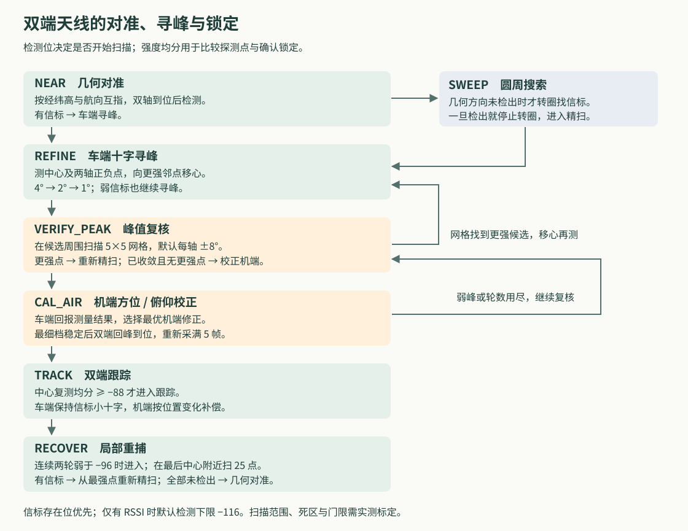

# 双端连续对准与信标跟踪

## 从地面开始连续对准

只要使能、两端设备就绪、导航和编码器有效，地面静止时即可完整运行。起飞、降落、爬升和横移都只改变输入位置；程序没有起飞定时器、高度触发器或地面/空中切换条件。已经跟踪就继续跟踪，处于捕获就继续当前捕获流程。几何距离小于 1 m 时视线不稳定，等待有效定位。

机端使用持久的 `AirHistory history = {0}` 和 `airborne_track_step(&history, now, &air, &reply)`。每端的定位帧包含十进制度、同基准高度、真实测量时间和有效位；只需输入实测航向。只有航向时，俯仰、横滚及可选角速度字段置零，表示水平或已调平基座。对于起飞中机体倾斜，单独航向不能补偿瞬时俯仰/横滚。每次调用都返回机载云台坐标系的绝对目标角。恢复或重启设备时才重新建立历史。

机端独立缓存本机与车端的定位。由间隔 50–2500 ms 的两次有效坐标差推算 ENU 速度，用于内部短时外推；第一帧或间隔过长时按最近位置指向。控制循环重读同一定位时间戳不会再估一次速度。预测时长为 `min(数据年龄 + lead_ms, 1200 ms)`，外部报文无需发送速度。预测适用于平缓运动，起飞加速度出现后要等新的定位帧才能反映。

车端初始地理方位减去 `rough_heading_deg`，得到云台基座下的候选方位，俯仰取几何仰角。粗航向不可用时，方位以现有编码器读数起步，仰角仍由位置给出。初值受粗航向误差影响。双方到位稳定后，在几何方向收到第一帧有效信标就锁存该点云台角，立即开始车端十字寻峰。从此位置、粗航向均不再叠加到车端接收中心；只有彻底失锁才重新做几何对准。方位输出 [0°,360°)，两轴均按本机编码器零点和正负号换算。

## 1 秒通信与 10 ms 采样

仿真按每秒一轮双向交换建模，位置、设备状态、机端修正请求和对应回执随这轮交换传输；车端仍每 10 ms 本地采信标并调用控制器。两板的定位数据需统一高度基准并把测量时刻折算到本机时钟。LoRa 接收端按传输帧序号排除重复、乱序数据，只有新的传输帧刷新接收时刻。设备就绪表示可工作，与无人机是否已起飞无关。

1. 车端发送会话号、机端点号和机端两轴修正。会话非零，机端修正每轴限 ±20°。机端收到新点后执行，编码器方位最短角差、俯仰误差均 ≤0.35° 才回报到位。同一机端点可以覆盖多个车端采样点。
2. 车端核对会话、点号和到位位。请求及回执的有效期均为 2500 ms，给 1 秒周期留出一次漏帧的余量。无匹配回执暂停计分，不能拿上个机端点的到位位计分；对外可显示 POINT。
3. 车端用发出本点命令之后的新编码器回读核对上一指令，两轴误差都 ≤0.25° 才开始驻留。连续稳定 40 ms 后，每个时间戳只收一次，采样年龄 ≤30 ms。几何对准与圆周搜索阶段一帧检出即进入寻峰。其他扫描阶段默认取 5 帧均分。漏帧、无信标或无效项按 −120 补入均值；同时独立记录该点是否有检出。完全无检出的点不参与最佳点比较。
4. 一轮开始时点号为 0、最高分初值为 −121。并列保留先测点。粗捕只检查有无信标；十字寻峰、宽网格复核和跟踪用均分比较。机端修正完成后，回到峰心重新驻留，满 5 个新样本且均分达到锁定门限才进入 TRACK。

## 各阶段怎样跳转

| 阶段 | 机端 | 车端 | 跳转条件 |
|---|---|---|---|
| **NEAR 几何对准** | 以两端经纬高和本机航向指向车端，编码器确认到位。 | 以几何方位减粗航向、几何仰角预置两轴，在该方向等有效信标帧。 | 一帧检出即进 REFINE；到位驻留后，本点观测结束仍无信标才进 SWEEP。 |
| **SWEEP 圆周找信标** | 保持候选修正并跟随位置变化。 | 按 10° 步进旋转方位；每点沿用同一检出判据。 | 首次检出即停止转圈并进 REFINE；整圈无信标则更换候选继续搜索。 |
| **REFINE 车端寻峰** | 保持发射修正并持续运动补偿。 | 五点十字比较信标均分；向较强邻点移心，稳定后缩小步长。弱于锁定门限也继续爬峰。 | 最细档稳定或达到本阶段轮数上限，进入 VERIFY_PEAK；整轮无检出则局部重捕。 |
| **VERIFY_PEAK 峰值复核** | 保持发射修正。 | 以候选峰为中心测 5×5 网格。发现比中心高出增益死区的点，移到该点重新精扫。 | 已精扫收敛且网格无更强候选才进机端校正；未收敛则继续精扫；全网格未检出则局部重捕。 |
| **CAL_AIR 机端校正** | 按车端请求分别探测方位、仰角，保留更强的修正。 | 保持接收中心，在机端探测轮之间插入车端小十字修正。 | 机端最细档稳定、双端回峰到位、中心复测满 5 帧且均分 ≥ −88 才锁定。弱峰或用尽轮数回到复核。 |
| **TRACK 双端跟踪** | 按最新定位和已学修正对车，继续运动补偿。 | 保持 1.25° 小十字信标跟踪。 | 连续两轮最强均分 < −96 进 RECOVER。默认关闭周期复校，健康时持续 TRACK。 |
| **RECOVER 局部重捕** | 保留机端修正并持续几何跟随。 | 围绕最后接收中心扫 5×5 局部网格，比较仍可检出的点。 | 有检出就从网格最佳点回 REFINE；整网格无检出才回几何对准，再决定是否转圈。 |

信标检测优先用接收机帧中的存在位。适配层设置 `has_beacon_flag=true` 并填入 `beacon_present`。此时即使强度为 −119，只要是新鲜、有效且范围正确的信标样本，也可启动寻峰；存在位为假时，高 RSSI 噪声不能触发。只有数值输出时，保持 `has_beacon_flag=false`，使用独立的 `detect_level`（默认 −116）估计有无信标。该值需按接收机空闲噪底实测标定。

车端首先测几何中心。无检出才全周找信标；全圈失败可更换机端 8° 候选或车端仰角行继续搜索。收到信标后寻峰完全在车端云台坐标系内进行。默认五点十字中邻点比中心强超过 0.45 才移心。随后以 4° 间隔比较每轴 ±8° 的较宽网格，用于发现可能隔着低谷的另一个峰。复核发现更强点就重新精扫；轮数上限仅切换搜索方式。机端随后也通过十字扫描校正方位和俯仰，回峰复测达标才锁定。

−88 的锁定门限可排除低于它的副瓣。高副瓣、多径和接收机饱和仍可能形成合格的局部峰。此处验证的是有限扫描范围内的采样峰，覆盖范围、网格步长和门限应按实测方向图、链路距离和噪底标定。实际信标始终很弱时，系统可继续寻峰而不宣告锁定。

两端云台的编码器和伺服指令都使用 0°～90°。0° 时天线面竖立、波束沿水平方向。读数增大时，机载天线向下俯、车载天线向上仰；到 90° 时两端天线面均水平，机端正对下方，车端正对上方。机端在姿态补偿后将方向转换为机械俯角。

## 默认参数

| 用途 | 参数与数值 |
|---|---|
| 检测与峰值复核 | `detect_level=−116`，`near_step_deg=4`（复核网格间距），`sweep_step_deg=10`，`row_step_deg=6`，`air_search_deg=8`，`acquire_level=−88`（锁定门限） |
| 五点精扫 | `refine_start_deg=4`，`refine_min_deg=1`，`refine_factor=0.5`，`refine_max_rounds=12`，`peak_margin=0.45` |
| 机端校正 | `air_refine_deg=4`，`air_min_deg=1`，`air_max_rounds=15`，`air_recheck_ms=0`（正值启用周期复校） |
| 信标跟踪与重捕 | `probe_deg=1.25`，`release_level=−96`，`weak_rounds=2`，`recover_step_deg=5`，`recover_radius_points=2` |
| 到位计分 | `arrival_tolerance_deg=0.25`，`settle_ms=40`，`sample_count=5`，`sample_window_ms=110`，`move_timeout_ms=4000` |
| 公共时效 | LoRa 周期 1000 ms；导航、设备状态、协调帧的时效 2500 ms；编码器 100 ms；机端最大外推 1200 ms |

通过 `VehicleConfig cfg = vehicle_defaults` 修改参数，随后一次调用 `vehicle_configure`。成功后重新捕获，失败则保持现状。起飞时请继续周期调用原对象。门限、步长及外推时长是仿真配置，实机需按波束宽度、接收机延迟和云台速度标定。

交互仿真按距离标定锁定门限，开启 `fast_acquire` 和 `fast_relock`。强峰经车端十字验证后可直接进入 CAL_AIR，首次锁定仍探测机端方位和俯仰，两端回峰并复测合格才进入 TRACK。失锁后局部搜索采用 3×3 网格；局部最优点低于锁定门限 8 dB 以上就重新几何对准。弱候选保留宽网格复核。

## 异常与适用范围

各工作阶段都有返回 NEAR 的优先通路。连续 250 ms 的新鲜极弱信号或接收机明确报告无信标，或连续 6 s 缺少当前点的匹配回执，会触发重新互指。极弱线默认为保持门限减 24 dB，下限为 −120。手动请求在下一控制拍生效。已完成几何检查后的持续无信标允许车端继续扫圈；定位和设备故障按下表处理。

| 条件 | 行为 |
|---|---|
| 未使能，或设备明确故障 | 输出 IDLE 或 FAULT，角度无效。设备状态恢复后重新从几何对准开始。 |
| 本端编码器无效或超过 100 ms，或对端设备状态超过 2500 ms | 输出 WAIT_DATA。数据恢复后重新开始捕获。 |
| 低质量或过期定位 | 机端和车端几何捕获需要新鲜定位；车端进入信标闭环后继续检查设备、链路、编码器和匹配回执，位置本身不参与双轴指令。机端无法生成到位回执时，车端暂停点的计分。 |
| 新鲜匹配回执持续报告机端未到位，或机端就绪后车端运动超时 | 健康设备等待 4 s 后重试同一点，机端请求更新点号。转动时间较长也会继续尝试；硬件故障由设备状态显式上报。单独漏一次 LoRa 交换不会判为信标丢失。 |
| 车端持续转弯或视线角变化很快 | 纯信标跟踪的响应取决于一次五点扫描耗时、探测步长与波束宽度。快运动或长遮挡可超过局部重捕范围，系统再用最新位置重新对准。 |

仿真使用 10 Hz 本地定位、1 Hz 双向 LoRa、100 Hz 控制及信标采样；仅注入经纬高、航向和设备反馈。初始无人机与车辆均在地面并水平分开，定位注入东向 +4 m、高度 +2 m 的小偏差。场景一在 37.08 s 完成双端跟踪，45 s 起飞；场景二模拟粗航向误差大，5 s 起飞时仍在扫圈，68.08 s 完成跟踪。两组均丢弃 78 s 的一轮通信、遮挡 95 s 起的 100 ms 以及 145–183 s 的长时段。长遮挡结束后分别在 241.08 s 和 242.08 s 恢复完整跟踪。
